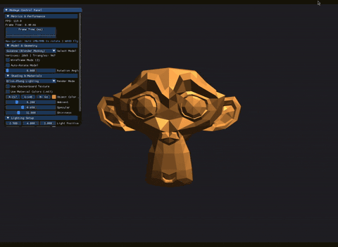
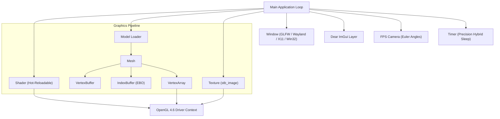

# Modeye 3D Graphics Engine

[](https://en.wikipedia.org/wiki/C%2B%2B17)
[](https://www.khronos.org/opengl/)
[](https://cmake.org/)
[](LICENSE.txt)
[](CMakePresets.json)

A modern, lightweight 3D graphics rendering engine and interactive sandbox built with **C++17** and **OpenGL 4.6 Core Profile**. Modeye is designed to provide clean, RAII-driven abstractions over the raw OpenGL state machine, featuring indexed rendering, Blinn-Phong lighting, runtime shader hot-reloading, robust OBJ asset loading, and a real-time debug interface powered by Dear ImGui.



---

## Key Features

- **Modern OpenGL 4.6 Core Profile**:
  - Zero deprecated immediate-mode APIs (`glBegin`/`glEnd`).
  - Synchronous driver debug messaging via `glDebugMessageCallback`.
  - 8x MSAA (Multi-Sample Anti-Aliasing) and hardware capability introspection.
- **Robust Resource Management (RAII)**:
  - Strong encapsulation following the Rule of 5 for buffers (`VertexBuffer`, `IndexBuffer`, `VertexArray`), shaders, textures, and windows.
- **Indexed Mesh Rendering**:
  - Efficient vertex deduplication using element buffer objects (`glDrawElements`), slashing memory consumption and vertex processing overhead.
- **Lighting & Visual Modes**:
  - **Blinn-Phong Shading**: Configurable ambient, diffuse, and halfway-vector specular lighting with material shininess controls.
  - **Surface Normal Visualizer**: Direct normal-to-RGB visualization mode.
  - **Unlit / Flat Mode**: Base color and UV evaluation.
  - **Wireframe Mode**: Dynamic line rendering toggle (`glPolygonMode`).
- **Live Shader Hot-Reloading**:
  - Recompile vertex and fragment shaders on the fly at the press of a key (`R`) without restarting the engine.
- **Asset Pipeline**:
  - Model loader supporting arbitrary polygonal meshes with automatic triangulation and normal generation (Suzanne monkey, Stanford Dragon).
  - 2D texture mapping with automatic mipmap generation and procedural fallbacks.
- **Interactive Dear ImGui Debug Layer**:
  - Real-time frame time graph and FPS counter.
  - Live model switcher, rotation controls, and lighting position/color dials.
  - Seamless navigation with visible cursor: click-and-drag viewport rotation with automatic cursor recapture.
- **Cross-Platform Zero-Install Build**:
  - Automatically fetches and compiles all third-party dependencies (`GLFW`, `GLAD`, `GLM`, `spdlog`, `stb`, `tinyobjloader`, `imgui`) via CMake `FetchContent`.

---

## Architecture Overview



---

## Controls & Keybindings

| Key / Input | Action |
| :--- | :--- |
| `Hold LMB / RMB & Drag` | Look around viewport (Euler pitch and yaw, infinite rotation) |
| `W` / `A` / `S` / `D` | Fly Forward / Left / Backward / Right |
| `Space` / `C` | Ascend / Descend vertically |
| `Mouse Scroll` | Zoom in / out (Viewport FOV) / Scroll UI panels |
| `R` | **Hot-reload Shaders** |
| `Z` | Toggle Wireframe mode |
| `Esc` | Exit application |

---

## Building & Running

Modeye uses CMake presets for hassle-free compilation on Linux and Windows. No manual package installation or system library linking is required.

### Prerequisites
- CMake 3.28 or higher
- C++17 compatible compiler:
  - GCC 9+ or Clang 10+ (Linux)
  - MSVC v143+ / Visual Studio 2022 (Windows)
- Build tool: `Ninja` or `make`

### Linux (Ubuntu / Debian / Fedora / Arch)

1. **Install graphics development headers** (if not already installed):
   ```bash
   sudo apt update
   sudo apt install -y build-essential cmake ninja-build libx11-dev libxcursor-dev libxinerama-dev libxrandr-dev libxi-dev libwayland-dev libxkbcommon-dev
   ```

2. **Configure and Build**:
   ```bash
   cmake --preset linux-debug
   cmake --build out/build/linux-debug
   ```

3. **Run**:
   ```bash
   ./out/build/linux-debug/modeye
   ```

### Windows (Visual Studio / Command Prompt)

1. Open project folder in Visual Studio 2022 (CMake support enabled) or run from Developer Command Prompt:
   ```cmd
   cmake --preset x64-release
   cmake --build out/build/x64-release --config Release
   ```
2. Launch `out/build/x64-release/modeye.exe`.

---

## Project Structure

```
modeye/
├── CMakeLists.txt              # Build configuration with FetchContent & asset packaging
├── CMakePresets.json           # Native presets for Linux, macOS, and Windows MSVC
├── README.md                   # Project documentation
├── assets/                     # 3D models (monkey.obj, dragon.obj)
├── shaders/
│   ├── mesh.vert               # Vertex shader (transformations & normal matrices)
│   └── mesh.frag               # Fragment shader (Blinn-Phong, normals, texture, unlit)
└── src/
    ├── Main.cpp                # Application entry, render loop & ImGui debug panel
    └── Core/
        ├── GL.hpp              # Central OpenGL / GLFW / GLAD includes
        ├── Gfx.hpp             # Consolidated graphics module headers
        ├── Log.hpp / .cpp      # spdlog color logging facility
        ├── Timer.hpp / .cpp    # High-precision frame limiter and delta time
        └── Gfx/
            ├── Camera.hpp / .cpp       # FPS flight camera with perspective projection
            ├── IndexBuffer.hpp / .cpp  # Element Buffer Object (EBO) RAII abstraction
            ├── Mesh.hpp / .cpp         # Indexed geometry draw calls
            ├── Model.hpp / .cpp        # Multi-shape OBJ model parsing & deduplication
            ├── Shader.hpp / .cpp       # GLSL compilation, reflection & hot-reload
            ├── Texture.hpp / .cpp      # 2D Texture abstraction with stb_image
            ├── Vertex.hpp              # Vertex layout (Position, Normal, UV)
            ├── VertexArray.hpp / .cpp  # Vertex Array Object (VAO) wrapper
            ├── VertexBuffer.hpp / .cpp # Vertex Buffer Object (VBO) wrapper
            └── Window.hpp / .cpp       # GLFW window & debug context wrapper
```

---

## License

This project is licensed under the MIT License - see [LICENSE.txt](LICENSE.txt) for details.
